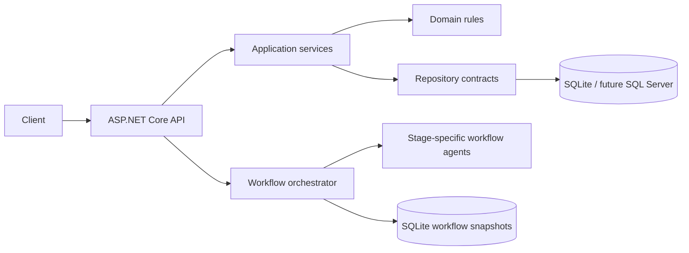

# Architecture Overview

## Runtime components

The Domain project owns URL validation, expiration, click behavior, and entities. Application owns use cases, repository contracts, and the `IUnitOfWork` boundary. Infrastructure owns EF Core mappings, migrations, provider-specific database configuration, generic repositories, Unit of Work, and workflow snapshot persistence. API owns HTTP, Problem Details, correlation IDs, logging, rate limits, health, and metrics. Orchestration owns the lifecycle state machine, dependency graph, scenario catalog, and stage-specific agents.

## Orchestration model

The engine creates these task nodes:

1. Requirements
2. Architecture, dependent on Requirements
3. Implementation, dependent on Architecture
4. Security Review and Performance Review, parallel after Implementation
5. QA Validation, dependent on both reviews
6. Observability
7. Release Readiness

Architecture and release-readiness are human approval gates. Each task records status, dependencies, attempts, error detail, and audit events. Autonomous retry is capped at three attempts. Exhaustion transitions the run to SafeStopped. A checkpoint is created before implementation; rollback restores task statuses to that checkpoint. Replanning invalidates only tasks at or after the impacted stage and increments the plan version.

Runs default to automatic dependency execution. Optional manual step mode executes the Requirements task when the run starts, then waits for an explicit advance for each next eligible task. Architecture and release-readiness still require human approval; in manual mode, approval makes the next task available without executing it.

Each agent produces inspectable outputs in the run snapshot:

- Requirements: normalized requirements, scenario classification, decisions, and ambiguity risks
- Architecture: decision record, API contract, persistence model, and architecture validation
- Implementation: implementation package, migration artifact, and build validation
- QA: test evidence and security, concurrency, and recovery validations
- Observability: traceability and operational-health validations
- Release: runbook, engineering summary, and release validation

## Data flow

A create request is validated by Domain rules, passed through the Application service, staged by a repository, and committed once through the Unit of Work. A redirect resolves the URL, rejects expired entries, increments its click count, and commits a click event. Analytics reads the indexed click-event table. Cache is deliberately not required for correctness in this first deployable path; a cache adapter can be added at the Application contract boundary.

## Governance and observability

Every request receives or propagates `X-Correlation-ID`. JSON console logging records request method, path, status, duration, and correlation ID. The metrics endpoint exposes total requests, success rate, and p50/p95/p99 latency. Orchestration audit entries include plan version, approvals, task outcomes, retry counts, checkpoints, safe-stop reason, and rollback events.

## Reliability decisions

- Database uniqueness is the final authority for aliases and short codes.
- Redirect correctness does not depend on a cache or analytics query.
- Analytics is recorded after the redirect target is resolved; analytics failure must be handled as an operational error rather than changing the destination decision in a production queue-backed implementation.
- In-process rate limiting is suitable for a single-node evaluation deployment. A distributed store is required for multiple nodes.
- Workflow snapshots use JSON for simple durable recovery. A normalized task/audit schema is the next SQL Server evolution when querying across runs becomes important.
