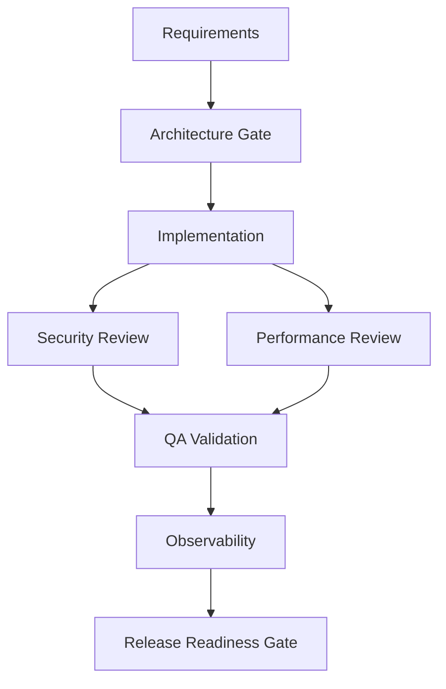

# Orchestration Specification

## Purpose

The orchestration layer turns a requirement into a reviewable engineering outcome. It is deterministic in this implementation so the evaluator can reproduce the same transitions, while the stage-agent contract can later be backed by an LLM or external worker without changing the governance engine.

Agents do not bypass the orchestrator. They produce artifacts and validation results; the orchestrator owns dependency execution, state transitions, retries, approvals, rollback, safe-stop, and persistence.

## Agent contract

`IWorkflowAgent` exposes:

- `Stage`: the lifecycle stage owned by the agent
- `ExecuteAsync(WorkflowRun, CancellationToken)`: consumes shared run context and writes stage outputs

Current agents:

| Agent | Outputs |
|---|---|
| Requirements Agent | normalized requirements, scenario decision, ambiguity risks |
| Architecture Agent | architecture decision record, API contract, persistence model, architecture validation |
| Implementation Agent | implementation package, migration artifact, build validation |
| QA/Validation Agent | QA evidence, URL security, concurrency, and recovery validations |
| Observability Agent | observability package, traceability and operational-health validations |
| Release Readiness Agent | release runbook, engineering summary, release validation |

## Dependency Graph

The security and performance tasks are independently eligible after implementation and execute in parallel in automatic mode. Manual mode advances one of those ready tasks per request. QA is synchronized on both. The graph is stored in each run snapshot with task IDs, dependencies, status, attempts, and errors.

## Execution modes

Automatic execution is the default: the orchestrator runs dependency-ready tasks until it reaches an approval gate. A custom run can opt into manual step mode with `stepMode: true`. Starting that run executes Requirements and returns `AwaitingStep`; `POST /api/orchestration/runs/{id}/steps` executes one next eligible task and returns the updated snapshot. When Architecture or Release Readiness requires approval, the run returns `AwaitingApproval`. Approval in manual mode enables the next step but does not execute it. The report UI at `/report.html` supports mode selection, step advancement, gate decisions, and loading a run by ID.

## State and gates

A run has these statuses:

- `Running`: ready tasks are being executed
- `AwaitingStep`: a manual-mode run is waiting for the user to execute one next task
- `AwaitingApproval`: a completed gated task is waiting for human approval
- `Replanning`: the active plan is being invalidated and replaced
- `Completed`: every graph task succeeded and release approval was recorded
- `Rejected`: a reviewer rejected the current gate
- `SafeStopped`: a task exhausted autonomous retries or an unrecoverable control failure occurred

The Architecture and ReleaseReadiness stages are mandatory approval gates. Completion of a task never implies approval.

## Retry and recovery

Each task has a maximum of three attempts. Each failure adds an audit entry, stores the latest error, and increments `RetryCount`. After the third failure:

1. The task becomes `Failed`.
2. The run becomes `SafeStopped`.
3. `SafeStopReason` explains the limit breach.
4. No dependent task is allowed to execute.
5. A human can inspect the run and choose rollback or a replan.

A checkpoint is captured before implementation. Rollback restores task statuses from the latest checkpoint, records a rollback event, increments `RollbackCount`, and resumes eligible tasks.

## Replanning

A replan increments `PlanVersion`, updates the requirements, determines the earliest affected stage, and marks tasks at or after that stage as `Invalidated`. Approvals for invalidated stages are removed. Unaffected completed work is retained when the impact is downstream. The new graph execution then stops again at the next required approval gate.

## Persistence and lineage

Workflow snapshots are serialized through `IWorkflowRunStore` and stored by the Infrastructure `WorkflowRunStore` in the relational database. The snapshot includes:

- requirements and scenario
- plan version and current stage
- task graph and attempts
- artifacts, decisions, risks, and validations
- approvals and reviewer rationale
- checkpoints and rollback count
- audit trail and safe-stop reason

This JSON snapshot is intentionally simple for the current submission. A SQL Server deployment can normalize tasks, approvals, audits, and metrics into queryable tables later.

## Controlled autonomy boundary

Agents may analyze, generate artifacts, and report validation outcomes. They may not:

- skip dependency checks
- approve their own architecture or release
- exceed three retries
- continue after safe-stop
- invalidate unrelated tasks
- mutate persistence outside the application contracts

Human reviewers own architecture approval, high-impact recovery decisions, and release approval.
